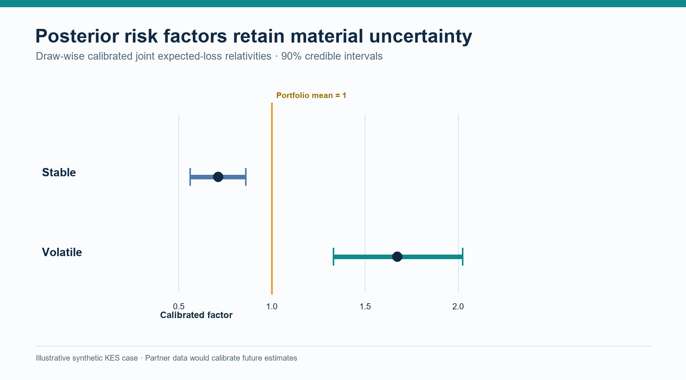
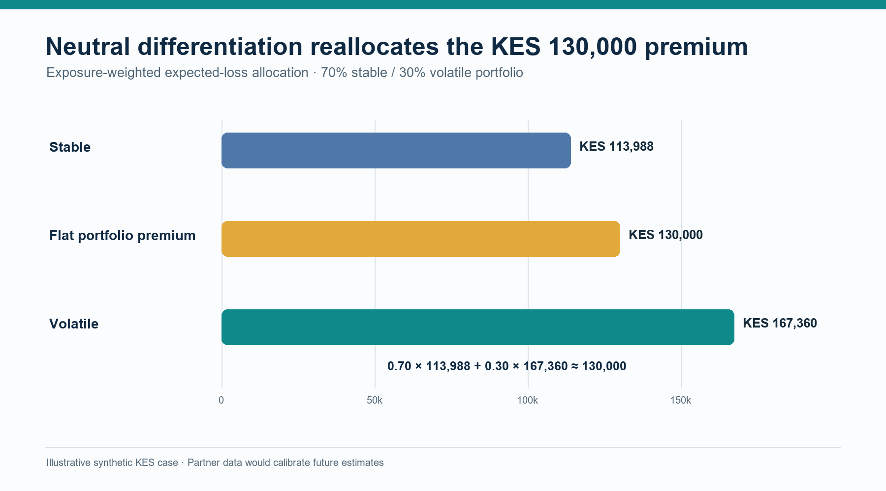
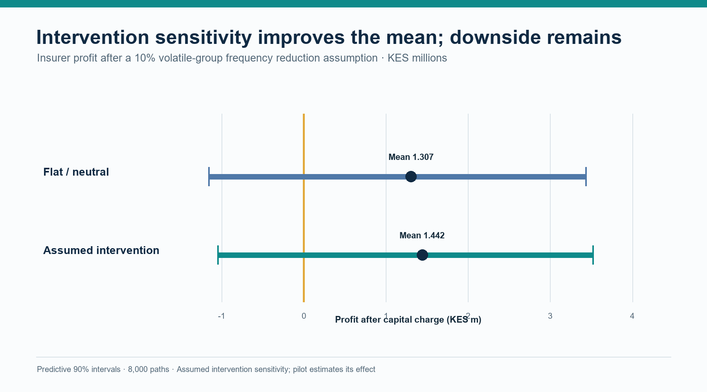
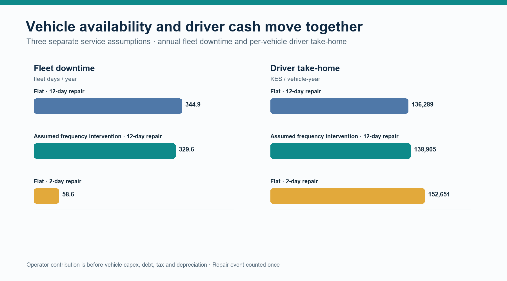

# From Telematics Evidence to Shared Value: Bayesian Relativities and Moove

**Nevil Maloba | 14 October 2026**

<!-- ARTICLE_BODY_START -->

## A practical question behind the model

What would an insurer, mobility operator and driver each need to see before a telematics-informed insurance programme creates shared value? The question grew from practical work on productive assets, repayment and disruptions to earnings. CGAP’s 2023 study, *Putting Gig Data to Work*, describes Moove and another platform using work data to expand gig-worker financial access [1]. Vehicle access, driver activity, repayment and support form one commercial relationship. I then asked how exposure and driving outcomes could inform insurance cost, safety support and economic value.

The project connection is specific. **Bayesian Relativities** estimates exposure-adjusted claim frequency, severity and uncertainty. **Mwendo Pamoja** follows operations, repairs, driver cash, repayment and financing. **Underwrite for Collection** contributes evidence governance, decision timing, intervention and outcome evaluation. Together they support a testable application for Moove and similar businesses whose income depends on productive vehicles. This article develops the insurance profit test and links it to operator and driver economics.

Three research questions organise the work:

1. How can exposure, claims and telematics support credible estimates of expected insurance loss at driver and fleet levels?
2. Which combination of insurance pricing, safety support, repair response and driver incentives improves outcomes for the insurer, operator and driver over time?
3. How do claims development, reinsurance, capital, operating costs and customer cash change the full-term profitability of that combination?

## Start with the observed operating setting

Moove’s United Kingdom Driver Hub describes vehicle access with insurance and servicing in packages paid weekly [2]. Its UK privacy policy lists location, speed, acceleration, deceleration and mileage among vehicle or telematics information, with uses connected to monitoring, risk and driver safety [3]. CGAP discusses Moove’s use of work data in gig-worker finance [1]. Together these sources establish the public operating setting and relevant data classes. An actuarial application would require linked, defined exposure and claims experience from the selected product and insurer.

Market and contract determine coverage, premium payer, deductible, claims, retention and outcomes. The UK package illustrates bundled insurance and servicing; the KES calculations are a separate hypothetical case. Partner data and terms would calibrate an indication. Apply the method using each market’s rates, currency, contract and governance.

## What the Bayesian insurance model estimates

Insurance cost begins with an exposure definition, such as kilometres, insured hours or covered vehicle-days. More driving creates more opportunities for a claim; the rate per exposure unit measures incidence for comparable driving. Severity measures cost given a claim. Theft while parked and other non-driving losses need their own exposure and predictors.

For driver i in period t, a simplified expected driving-loss calculation is:

**Expected driving lossᵢₜ = exposureᵢₜ × base claim rate × frequency relativityᵢₜ × base severity × severity relativityᵢₜ**

Selected telemetry—mileage, route, speed, braking, vehicle and road conditions—can inform each model when its definition and evidence are sound. Frequency estimates claims per exposure; severity estimates cost per claim. Shared effects capture drivers of both. Longitudinal research documents dependence between frequency and severity [4], so calculate expected loss jointly from posterior draws when dependence matters.

The Bayesian Relativities paper builds a hierarchical architecture around these quantities. Approved tariff variables establish the base. Driver, fleet, vehicle and territory group effects allow partial pooling: a new driver’s estimate begins informed by relevant collective experience, while accumulated exposure and mature claims progressively contribute more individual evidence [5], consistent with actuarial work on hierarchical credibility [6]. The model keeps the expected-loss calculation visible and reports its uncertainty. It also distinguishes an estimate of a driver’s underlying expected loss from the distribution of claims that might actually occur in a future period.

*Figure 1. Exposure-normalised Bayesian claim relativities with 90% credible intervals.*

## A worked illustration from the paper

The paper contains a hypothetical pre-calibration calculation that makes exposure and risk easy to distinguish. It assumes a base rate of 0.08 claims per 10,000 kilometres and a base claim severity of KES 180,000. Amina travels 2,000 kilometres in the period and has a frequency multiplier of 0.85 and severity multiplier of 0.95. Kamau travels 3,200 kilometres, with multipliers of 1.20 and 1.10.

**Amina: 2,000 ÷ 10,000 × 0.08 × 0.85 × KES 180,000 × 0.95 = KES 2,325.60**

**Kamau: 3,200 ÷ 10,000 × 0.08 × 1.20 × KES 180,000 × 1.10 = KES 6,082.56**

These are expected driving-claim costs under the illustration’s assumptions; a customer premium adds expenses, risk transfer, capital and commercial terms. Kamau’s expected loss reflects both higher exposure and higher risk multipliers. Exposure adjustment separates total claim cost from the rate per kilometre.

## Credibility should show its uncertainty

Telematics records can be frequent while claims remain sparse, and large losses can dominate severity. Bayesian estimation combines observed exposure and claims with group and individual risk distributions. This extends the credibility idea of blending personal and collective experience according to its volume and reliability [7], while providing both a posterior for underlying risk and a predictive distribution for future claims.

For review, report exposure and claim maturity, frequency and severity relativities, credible intervals, a predictive loss interval, group support, missingness and data quality. The credible interval describes uncertainty in the expected rate; a predictive interval also includes random future claim counts and amounts. Interval width can guide human review or a targeted evidence request, with calibration checks determining whether the uncertainty is reliable.

The paper’s recursive Gamma–Poisson frequency and inverse-Gamma–Gamma severity updates support computational feasibility: sufficient statistics refresh driver experience between broader model runs. A governed record captures priors, data cut-offs, posterior draws, calibration factor and reviewer action. The same uncertainty then informs tariff, claims-development, capital and reinsurance analysis.

## Relativities are a pricing allocation, not a profit result

An exposure-normalised relativity allocates an approved expected-loss level across the selected portfolio. In simplified form, let qᵢ be each risk’s raw relative expected loss and wᵢ its exposure weight. A draw-specific calibration factor can be defined so the weighted average calibrated relativity equals one:

**A = (Σᵢ wᵢ) ÷ (Σᵢ wᵢ qᵢ), rᵢ = A × qᵢ, Σᵢ wᵢ rᵢ ÷ Σᵢ wᵢ = 1**

The population and weight may be vehicle-years, kilometres or insured days; applying the factor to each posterior draw preserves uncertainty. The calculation reallocates expected loss within that group while preserving its selected mean. Safety improvement and cost savings require separate evidence.

The commercial premium adds claim handling, acquisition, administration, reinsurance, capital, applicable taxes and approved terms. The insurer’s rules and driver agreement determine actual prices and renewal changes. Relativities inform that approved design. Portfolio mix, renewal and selection are monitored because they can change the experience represented by the calibration.

*Figure 2. Exposure-weighted tariff allocation compared with a flat premium.*

## Profit testing needs three ledgers

“Does the programme make money?” has three answers because each participant carries different costs and risks.

**Insurer ledger.** Track premium earned and received, gross claims incurred and paid, claim and operating expenses, reinsurance premiums and recoveries, recoverable delays, investment income, reserve movement, taxes and required capital. This shows insurance sustainability and the range of shareholder returns.

**Mobility operator ledger.** Track insurance costs, retained losses, deductibles, repairs, servicing, downtime, replacement transport, telematics, collections, funding expense, acquisition, retention and contracted residual value. This tests operating contribution and customer relationship value.

**Driver ledger.** Track settled fares, platform charges, energy, other operating costs, insurance, excesses, debt service, incentives, driver-funded repairs, working days and cash after essential needs. Sustainable work and customer outcomes remain explicit alongside the company profit measures.

Calculate each ledger by period, present value and downside scenario. For mobility operator M in period t, define the change in contribution as:

**ΔCFᴹₜ = insurance savings + avoided retained losses + uptime value + retention value − incentive cost − intervention cost − added operating cost − funding cost**

Assign each term once: repair uptime through availability; driver premium benefit to the operator only when it pays; reinsurance recovery to the insurer unless a contract passes it through.

*Figure 3. Insurer profit test with posterior uncertainty intervals.*

## Follow insurance cash beyond the pricing date

Motor profit testing follows claims from accident through reporting, case estimation, development and payment. The insurer needs incurred and paid distributions by accident, report and payment period, with reserve uncertainty; earned premium, claim liabilities and available cash change on different dates. Reserving standards call for methods suited to the exposures, claim adjustment process and potential recoverables [8].

Underwriting accounting and shareholder cash flow are separate. For insurer period t, define underwriting result UWₜ as:

**UWₜ = earned premiumₜ − incurred gross claimsₜ − expensesₜ − ceded premiumₜ + recognised reinsurance recoveriesₜ**

Incurred claims include reserve movement; payments remain separate cash flows. The investor projection records premium, claims, expenses, reinsurance, investment return and capital distributions. Reconcile balance sheet and cash each period under one convention.

Reinsurance changes net-loss distribution and cash timing. A quota share cedes a stated portion of covered premium and claims; excess-of-loss responds above an attachment and within a limit. Wording, exclusions, reinstatements, commissions, counterparty credit and settlement delays determine recoveries. Model those cash dates and reinsurer non-performance. IFRS 17 measures reinsurance contracts held separately from underlying insurance and includes non-performance risk [9]. Accounting measurement, economic capital and commercial price margins remain distinct.

IAIS guidance connects risk appetite with reinsurance, capital, liquidity, concentration and counterparty risk [10]. Simulate gross and net losses through the insurer’s capital policy; report one-year capital, ultimate cohort outcomes, capital-floor probability, liquidity gaps and risk by segment. Common shocks—weather, road disruption, workshop congestion or incentives—can affect losses and downtime across vehicles.

## A hypothetical fleet test

The companion research case projects a synthetic 100-vehicle portfolio for 12 months, using three years of hypothetical stable/volatile-group claims. It applies Gamma–Poisson frequency and inverse-Gamma–Gamma severity updates, then normalises joint expected-loss relativities. The KES scenario specifies cohort shares, base rates, non-driving loss, gross premium, a 20% quota share, expenses, capital and claim-payment patterns. It uses no Moove, insurer, broker or driver portfolio data and is not a market quotation.

The test compares three designs. **Baseline** applies a flat commercial premium. **Neutral differentiation** applies posterior frequency and severity relativities after draw-wise calibration, keeping the 70/30 weighted premium at KES 130,000. **Intervention** adds a stipulated 10% frequency reduction for the volatile group as a sensitivity for a future safety programme. Reporting is delayed by one to three months and settlement by one to nine months. A common-shock stress applies correlated loss and downtime across the whole fleet. Each design runs through insurer, operator and driver cash ledgers.

The hypothetical history gives stable vehicles 756 units of 10,000 kilometres and 47 claims, with KES 170,000 average severity; volatile vehicles have 324 exposure units, 41 claims and KES 205,000 average severity. Frequency multipliers use Gamma(2, rate 2) priors; severity multipliers use inverse-Gamma(4, 3) priors and a Gamma severity kernel of shape 2. With base rate 0.08 per 10,000 kilometres and base severity KES 180,000, 12,000 posterior draws give mean frequency multipliers 0.784/1.540 and severity multipliers 0.946/1.134 for stable/volatile groups. Jointly calibrated factors are 0.711 and 1.674, with 90% credible intervals [0.561, 0.859] and [1.329, 2.023]. The 2% common shock raises expected loss by a factor of 1.025:

**Expected shock multiplier = 1 + 0.02 × (1.8 × 1.25 − 1) = 1.025**

Expected total pure loss is KES 67,740 per vehicle-year (KES 55,440 driving, KES 12,300 non-driving). The KES 130,000 flat premium leaves a KES 62,260 commercial layer; neutral group premiums KES 113,988/KES 167,360 weight to KES 130,000 at 70/30.

Neutral differentiation reallocates expected loss while preserving the portfolio average. Across 8,000 simulations, flat and neutral designs have mean gross ultimate claims of KES 6.739 million and net claims of KES 5.391 million after the 20% quota share. Claim expense is KES 0.202 million, net reinsurance premium KES 1.950 million and operating expense KES 3.380 million. Mean insurer profit after a 10% capital charge is KES 1.307 million; its 90% predictive interval is −KES 1.158 million to KES 3.434 million, with 15.8% probability of loss and KES 107,852 gross break-even premium per vehicle. Net-loss 99.5% VaR is KES 13.093 million; TVaR is KES 14.491 million and economic capital KES 7.702 million. These are illustrative economic measures, not regulatory capital figures.

The intervention sensitivity stipulates a 10% frequency reduction for volatile vehicles, saving KES 9,280 expected driving loss per eligible vehicle-year, or KES 2,784 per portfolio vehicle-year at a 30% volatile share. It allocates 75% of eligible savings to premium reduction (KES 6,960 per volatile vehicle; KES 2,088 per portfolio vehicle) and 25% to an operator-funded driver incentive (KES 2,320/KES 696). Portfolio premium falls to KES 12.791 million. Mean profit after capital rises to KES 1.442 million; its 90% predictive interval is −KES 1.048 million to KES 3.518 million, with 13.41% probability of loss and KES 103,473 break-even gross premium per vehicle. This is an assumed treatment effect; only mature, comparable pilot data could estimate an intervention effect.

The same annual fleet case tracks operator and driver cash. With scheduled collection and standard 12-day repairs, operator contribution before vehicle capital expenditure, debt, tax and depreciation is KES 102.599 million (KES 1.026 million per vehicle); driver take-home after household, package and downtime costs is KES 136,289 per vehicle-year. Under the intervention, downtime falls from 344.95 to 329.61 fleet days, operator contribution rises to KES 102.673 million and driver take-home to KES 138,905. A two-day repair scenario lowers downtime to 58.61 fleet days and raises driver take-home to KES 152,651; an assumed KES 146,871 expedite surcharge reduces operator contribution to KES 102.452 million. This separates the value of reduced claim frequency from repair-speed economics.

Mwendo’s separate operating bridge is a hypothetical 156-week vehicle agreement: KES 70,000 weekly fares, KES 25,000 package and KES 130,000 annual insurance, with 12-day and authorised 2-day repair scenarios. Under its 50% premium pass-through, neutral rates move the weekly package −KES 153.96 for the stable profile and +KES 359.23 for the volatile profile; intervention plus incentive moves the volatile adjustment to +KES 247.70. These are Mwendo outputs, not Moove terms. Its one-vehicle repair and finance case remains separate from the 100-vehicle insurance portfolio, with repair effects counted once through availability.

*Figure 4. Repair downtime and resulting driver cash in a hypothetical fleet test.*

## Measure intervention value as an outcome

The flat tariff is the baseline; normalised relativities test expected-loss allocation; an intervention test measures an action’s effect. A lower posterior among coached drivers can reflect prior behaviour or route choice, so define eligibility, timing, exposure, outcomes and comparison conditions to estimate treatment effect.

Where feasible, randomise optional support among eligible drivers while everyone keeps standard safety and servicing. Measure claims per distance, severity, downtime, earnings, missed payments, collection costs, retention and complaints. Depot rollout may need cluster assignment. Report intention-to-treat effect, delivery fidelity, subgroup results and uncertainty after allowing claims to develop.

Specify benefit sharing first. A measured loss reduction can fund a premium adjustment, reward or servicing support. The insurer tests claims, expenses, reinsurance and capital; the operator tests uptime, retention and programme cost; the driver sees weekly obligations and take-home cash. Link each benefit to its recipient.

## Profit testing across capital and reinsurance

Robbin and Malhotra simulate multi-year underwriting, capital, dividends, liquidation and shareholder returns [11]. Their results show conditions where reinsurance improves return durability despite a risk load, and identify expenses, taxes and payment patterns as useful extensions. This mobility case adds claim delays, treaty recovery, operator economics, driver cash and common shocks.

For each posterior draw, the test generates claims, reporting and payment dates, treaty recoveries, reserve movement, capital and insurer cash. Operator and driver paths record insurance, retention, repairs, downtime, collections, funding, receipts, weekly charges and incentives. Report mean and median present value, intervals, capital or liquidity breach probability, and the chance of crossing agreed outcome thresholds.

Choose long-term profitability measures to match the capital objective. Net combined ratio and underwriting margin explain annual results; shareholder internal rate of return uses capital, dividends and terminal distributions; expected shortfall and capital-floor probability describe downside. Define each metric’s denominator, horizon and investment-income basis. Only 8,000 predictive paths were simulated, leaving about 40 beyond the 99.5% quantile. VaR and TVaR are coarse tail estimates; production use would require more simulations, convergence checks and capital-model sensitivity.

## Governance that keeps the numbers useful

Create an evidence chain for each decision. Pricing receives exposure, claims maturity, posterior relativities, calibration, price components and explanation. Safety receives a timely state signal and approved action menu; reserving receives occurrence, report, payment and estimate dates; capital and reinsurance receive gross/net distributions, treaty attachment and recovery timing. Moove receives quantities tied to its contracts and costs. Driver communications explain price or reward changes and provide review routes.

Agree the purpose, access, retention, sharing, fields, responsibilities and driver communications. A data dictionary defines exposure units, event timestamps, device quality, claim status, severity basis, repair milestones, policy boundaries and payment dates. Correlation identifiers link operator, insurer and servicing records; decision rights and model versions make outputs traceable. Monitor missingness, device drift, calibration, normalisation, intervention effects and customer outcomes.

## A route from research to an applied pilot

Map market, coverage, premium payer, deductible, claims, telematics, vehicle agreement, repairs, driver communication and permissions in a data workshop. Reconstruct exposure and claim maturity, separate driving and non-driving loss, and compare tariff and credibility benchmarks through posterior checks, subgroup tests and out-of-time validation. Shadow score before using estimates and intervals in review.

Choose one controllable intervention, such as fatigue support or repair response. Pre-specify insurer claims, expenses and treaty terms; operator premium, retained loss, uptime and funding; and driver charges, incentives and essential cash. Test claim delay, large loss, common shock, reinsurance cost, repair time, participation and retention. A decision gate reviews evidence, uncertainty, benefit and funding by party.

Together, the projects complete a business test: Bayesian Relativities estimates credible loss, Mwendo Pamoja connects coverage, repairs and financing, and Underwrite for Collection governs interventions and outcome evaluation. Moove and similar operators can select a market, decision and data, then measure benefits, costs and outcomes over the contract and claims horizon.

<!-- ARTICLE_BODY_END -->

## References

[1] M. Anand and G. Murthy, “Putting Gig Data to Work: Innovations in Expanding Credit Access,” CGAP Brief, Jun. 2023. [Online]. Available: https://documents1.worldbank.org/curated/en/099063023143011873/pdf/P17436207747210ff096970c02a59ed1daf.pdf

[2] Moove, “Customer Hub,” United Kingdom. Accessed: Oct. 14, 2026. [Online]. Available: https://uk.moove.io/customer-hub/

[3] Moove, “Privacy Policy,” United Kingdom. Accessed: Oct. 14, 2026. [Online]. Available: https://uk.moove.io/privacy-policy/

[4] G. Y. Lee and P. Shi, “A dependent frequency–severity approach to modeling longitudinal insurance claims,” *Insurance: Mathematics and Economics*, vol. 87, pp. 115–129, 2019, doi: 10.1016/j.insmatheco.2019.04.004. [Online]. Available: https://www.sciencedirect.com/science/article/pii/S0167668718301951

[5] N. Maloba, *Bayesian Credibility and Exposure-Normalised Telematics Relativities*, technical white paper, 2026. [Online]. Available: https://github.com/TheAlchemistNerd/bayesian-telematics-relativities/blob/main/whitepapers/telematics-relativities/paper.md

[6] H. Belhadj, V. Goulet, and T. Ouellet, “On parameter estimation in hierarchical credibility,” *ASTIN Bulletin*, vol. 39, no. 2, pp. 495–514, 2009, doi: 10.2143/AST.39.2.2044645. [Online]. Available: https://www.cambridge.org/core/journals/astin-bulletin-journal-of-the-iaa/article/abs/on-parameter-estimation-in-hierarchical-credibility/630A49D6B48A8FE019222FC50014DCB1

[7] H. Bühlmann, “Experience rating and credibility,” *ASTIN Bulletin*, vol. 4, no. 3, pp. 199–207, 1967, doi: 10.1017/S0515036100008989. [Online]. Available: https://www.cambridge.org/core/journals/astin-bulletin-journal-of-the-iaa/article/experience-rating-and-credibility/B9A879CE4A73397C653963B474A7F954

[8] Actuarial Standards Board, “ASOP No. 43: Property/Casualty Unpaid Claim Estimates,” adopted 2007, revised 2011. [Online]. Available: https://www.actuarialstandardsboard.org/asops/propertycasualty-unpaid-claim-estimates/

[9] IFRS Foundation, *IFRS 17 Insurance Contracts: Pocket Guide on Reinsurance Contracts Held*. London, U.K., 2018. [Online]. Available: https://www.ifrs.org/content/dam/ifrs/supporting-implementation/ifrs-17/ifrs-17-pocket-guide-on-reinsurance-contracts-held.pdf

[10] International Association of Insurance Supervisors, *Insurance Core Principles and Common Framework for the Supervision of Internationally Active Insurance Groups*, Dec. 2024. [Online]. Available: https://www.iais.org/uploads/2024/12/IAIS-ICPs-and-ComFrame-adopted-in-December-2024.pdf

[11] I. Robbin and A. Malhotra, “Modeling the impact of capital management and reinsurance on long-term profitability,” *CAS Forum*, Summer 2023. [Online]. Available: https://forum.casact.org/article/83958-modeling-the-impact-of-capital-management-and-reinsurance-on-long-term-profitability

## Publication record

Main article word count: **3,000 words**. The count includes section headings, research questions and displayed equations between the body markers; it excludes the title, byline, reference list and this publication record. Unicode letter/number tokens are counted; apostrophe- and hyphen-connected tokens count as one; citation markers and numbered list labels are excluded. The companion verification file records the counting method and source coverage.

Licence: Creative Commons Attribution-NonCommercial-ShareAlike 4.0 International, https://creativecommons.org/licenses/by-nc-sa/4.0/.
